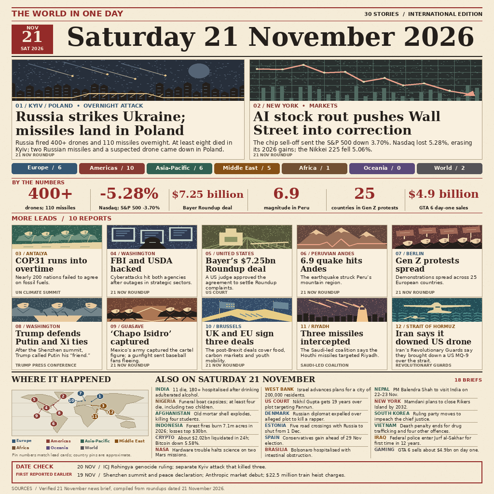

# The World in One Day

[](https://make.fun/bounty/news-image-20261121?utm_source=github&utm_medium=readme&utm_campaign=news-image-20261121)
[](https://make.fun/bounty/news-image-20261121/leaderboard?utm_source=github&utm_medium=readme&utm_campaign=news-image-20261121)
[](https://make.fun/bounty/news-image-20261121/leaderboard?utm_source=github&utm_medium=readme&utm_campaign=news-image-20261121)

A 1024 × 1024 newspaper front page for Saturday 21 November 2026, made for the [make.fun world news image bounty](https://make.fun/bounty/news-image-20261121?utm_source=github&utm_medium=readme&utm_campaign=news-image-20261121). It has 12 illustrated leads, 18 briefs, a locator map, and a date check for stories first reported earlier.



Run the Program/v1 entry locally:

```sh
MAKEFUN_OUTPUT_DIR=./output python3 main.py
```

The runner defaults to `/output`, where it copies the bundled PNG and verifies the copy byte for byte. It uses only the Python standard library and needs no network access.

To rebuild the art, run `python3 compose.py` with Pillow 10.2.0 and the DejaVu Serif and Sans fonts in `/usr/share/fonts/truetype/dejavu`. The compositor draws the illustrations and map with Pillow, uses fixed seeds for the paper and engraving textures, and measures text before placing it. The story lists drive the editorial counts and region chips.
